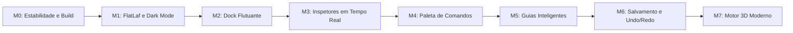

# Roadmap de Execução — square

Este documento estabelece o plano sequencial de desenvolvimento para a modernização do **square**. Cada marco é pequeno, incremental, possui critérios de aceitação objetivos e verificáveis, e prioriza a estabilidade estrutural e a experiência visual antes de avançar para subsistemas mais complexos.

---

## Visão Geral das Fases

---

## Marco 0: Fundação, Estabilidade do Ambiente e Baseline

**Objetivo:** Consolidar os scripts de compilação, assegurar reprodutibilidade total do build no JDK 25 e estabelecer a suíte básica de testes de fumaça sem quebras.

- [x] Validar compilação do núcleo sem intermediários (`./scripts/verify-core.sh`).
- [x] Validar compilação dos módulos Gradle (`./gradlew :sh3d-core:jar` e `./gradlew :app:classes`).
- [x] Criar teste de integração automatizado para leitura e escrita de projetos `.sh3d` e importação de catálogo `.sh3f`.
- [x] Estabelecer baseline de documentação viva (`AGENTS.md`, `docs/VISION.md`, `docs/ARCHITECTURE.md`, `docs/CODING_STANDARDS.md`, `docs/VERIFICATION.md`).

**Critério de Aceite:**
- Execução limpa com código de saída `0` em `./scripts/verify-core.sh` e `./gradlew :sh3d-core:jar`.
- Zero advertências críticas de sistema ou dependências nativas ausentes.

---

## Marco 1: Look & Feel Moderno (FlatLaf) e Suporte a Dark Mode

**Objetivo:** Substituir o visual datado do Swing por uma base estética contemporânea, nítida em HiDPI e com alternância suave entre temas Claro e Escuro.

- [x] Integrar a biblioteca **FlatLaf** como Look & Feel padrão no bootstrap da aplicação.
- [x] Criar a classe `ThemeManager` para alternar dinamicamente entre `FlatLightLaf` e `FlatDarkLaf`.
- [x] Definir tokens de cores semânticos para a interface e para a área de desenho da planta 2D (`theme.plan.background`, `theme.plan.grid`, `theme.plan.wall`).
- [x] Adaptar o `PlanComponent` para renderizar réguas, grade, paredes e seleções com contraste ideal no modo escuro.
- [x] Estilizar os divisores do layout (`JSplitPane`) para linhas limpas e minimalistas.

**Critério de Aceite:**
- O usuário consegue alternar entre modo Claro e Escuro através do menu ou atalho.
- Todos os 4 quadrantes (Catálogo, Tabela, Planta 2D e View 3D) atualizam suas cores instantaneamente sem falhas gráficas ou perda de legibilidade no desenho 2D.

---

## Marco 2: Dock Flutuante de Ferramentas (Estilo Figma)

**Objetivo:** Desacoplar a barra de ferramentas superior fixa, liberando espaço vertical e adotando um dock flutuante ergonômico sobreposto ao canvas.

- [x] Implementar o componente `FloatingDockComponent` em Swing com bordas arredondadas, fundo translúcido e sombra suave.
- [x] Posicionar o dock na parte superior central da área de trabalho utilizando `JLayeredPane` (`DockOverlayPane`).
- [x] Conectar os botões do dock diretamente às ações existentes no `HomeController` (`ActionType.SELECT`, `CREATE_WALLS`, `CREATE_ROOMS`, etc.).
- [x] Organizar os botões em grupos visuais coesos (Seleção/Navegação, Criação Arquitetural, Elementos Auxiliares e Modos 3D).
- [x] Adicionar microinterações visuais de hover, estado ativo, cantos arredondados e suporte dinâmico a drag/movimentação.
- [x] Ocultar a antiga barra de ferramentas fixa de `BorderLayout.NORTH` por padrão, mantendo alternância via menu Square (`Ctrl+Shift+B` e `Ctrl+Shift+F`).

**Critério de Aceite:**
- A barra cinza estática superior é eliminada por padrão, ganhando espaço vertical significativo na planta e na visualização 3D.
- O dock flutua sobre o topo da área central, com suporte a arraste e resposta dinâmica a mudanças de tema claro/escuro.
- 100% das ferramentas anteriores continuam funcionais e com estados selecionados sincronizados.

---

## Marco 3: Inspetor de Propriedades em Tempo Real (Substituição de Modais)

**Objetivo:** Eliminar diálogos modais bloqueantes para edição de elementos arquiteturais, substituindo-os por um painel lateral reativo.

- [x] Desenvolver o componente `PropertyInspectorPanel` na lateral direita da área de desenho.
- [x] Desacoplar os formulários de edição de modais bloqueantes para inspeção reativa contínua.
- [x] Implementar observadores de seleção no `Home`:
  - Seleção de Parede: exibe espessura, comprimento, altura, coordenadas X/Y e cores de acabamento.
  - Seleção de Móvel: exibe nome, largura, profundidade, altura, elevação, rotação, visibilidade e cor.
  - Seleção de Cômodo: exibe área calculada em m², nome, cor do chão e cor do teto.
  - Seleção de Cota / Texto: exibe dimensão e conteúdo textual.
  - Nenhuma seleção: exibe resumo quantitativo do projeto (total de paredes, móveis e cômodos).
- [x] Vincular as alterações de inputs do usuário diretamente aos modelos com atualização em tempo real na planta 2D e na visualização 3D.
- [x] Garantir que cada alteração seja registrada adequadamente no `UndoManager` via `UndoableEditSupport` para suporte total a `Ctrl+Z`.
- [x] Fornecer alternância de visibilidade do inspetor via menu Square e atalho `Ctrl+Shift+I`.

**Critério de Aceite:**
- Clicar em qualquer parede ou móvel na planta 2D abre seus atributos no inspetor lateral instantaneamente.
- Alterar um valor numérico reflete na planta 2D e na visualização 3D em tempo real, sem exibir nenhum diálogo modal bloqueante.

---

## Marco 4: Paleta de Comandos (`Ctrl+K`)

**Objetivo:** Permitir busca e inserção rápida de móveis e execução de ferramentas diretamente pelo teclado.

- [x] Criar o componente visual da paleta de comandos (`CommandPaletteDialog` flutuante e centralizado).
- [x] Registrar atalho global de teclado `Ctrl+K` (e `Cmd+K` no macOS) em toda a aplicação.
- [x] Indexar em memória as peças do `FurnitureCatalog` e as ações do `HomeController` (`CommandPaletteModel`).
- [x] Implementar busca incremental com filtragem rápida por palavras-chave e categorias.
- [x] Ao selecionar um móvel na busca, adicioná-lo diretamente à planta no centro da visão.
- [x] Ao selecionar uma ferramenta ou comando, executá-la imediatamente e fechar a paleta.

**Critério de Aceite:**
- Pressionar `Ctrl+K` abre o campo de busca em menos de 100 ms com campo de texto focado.
- Digitar termos como "cadeira", "porta", "parede" ou "salvar" exibe os resultados filtrados instantaneamente. Pressionar `Enter` ativa a ferramenta ou insere o móvel selecionado.

---

## Marco 5: Guias Inteligentes (Smart Guides) e Réguas Dinâmicas

**Objetivo:** Elevar a precisão e velocidade do desenho 2D com linhas guia magnéticas e medição automática de distância em relação a elementos adjacentes.

- [x] Extrair a renderização de alinhamento do monolito `PlanComponent.java` para `SmartGuidesRenderer`.
- [x] Implementar cálculo em tempo real de alinhamento de arestas (esquerda, direita, centro, topo, base) entre o elemento sendo manipulado e os elementos vizinhos mais próximos.
- [x] Renderizar linhas guia sutis (guias magenta/azuis) que se acendem quando o elemento atinge o ponto de snap.
- [x] Exibir balões com a cota numérica da distância em centímetros até a parede ou móvel adjacente mais próximo durante o arraste.

**Critério de Aceite:**
- Ao mover um móvel ou desenhar uma parede próxima a outra, linhas guia magnéticas surgem automaticamente com indicação precisa da distância em tempo real.
- O recurso opera de forma suave e desacoplada em tempo real sobre a planta 2D.

---

## Marco 6: Salvamento Contínuo e Histórico de Ações Aprimorado

**Objetivo:** Assegurar preservação total do trabalho do usuário com salvamento contínuo em segundo plano e histórico visual de undo/redo.

- [ ] Refatorar o `AutoRecoveryManager` para operar com snapshots imutáveis do modelo de dados (`Home`), gravando o estado em thread de background (I/O) sem interferir na taxa de quadros da UI.
- [ ] Implementar histórico visual de ações (`ActionHistoryPanel`), permitindo que o usuário visualize a lista de passos executados e retroceda para qualquer ponto anterior com um clique.

**Critério de Aceite:**
- O salvamento em background ocorre silenciosamente sem engasgos ou quedas de FPS no desenho ou rotação 3D.
- O histórico de `undo/redo` exibe os nomes descritivos das últimas 30 ações realizadas e permite restauração precisa.

---

## Marco 7: Modernização e Desempenho do Motor 3D em Tempo Real

**Objetivo:** Otimizar o loop de renderização 3D, permitir atualização incremental de geometria e adicionar suporte a formatos 3D modernos.

- [ ] Desacoplar a geração de malhas tridimensionais das dependências estritas do Java3D legado.
- [ ] Implementar atualização incremental do grafo de cena: atualizar apenas a malha da parede ou móvel modificado, em vez de reconstruir o cenário inteiro a cada evento.
- [ ] Adicionar suporte à importação de modelos no formato moderno GLTF/GLB (com texturas embutidas e materiais PBR), mantendo compatibilidade com arquivos `.obj` e `.3ds` legados.

**Critério de Aceite:**
- Navegação fluida em projetos grandes com mais de 500 objetos em 60 FPS contínuos.
- Capacidade de importar e renderizar arquivos `.gltf`/`.glb` com materiais e texturas corretas no catálogo e na visualização 3D.

